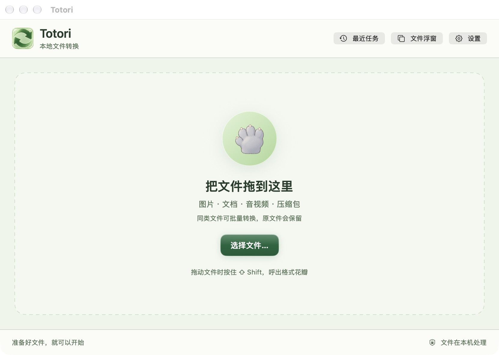
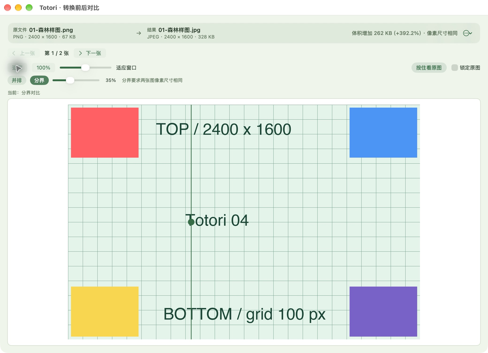
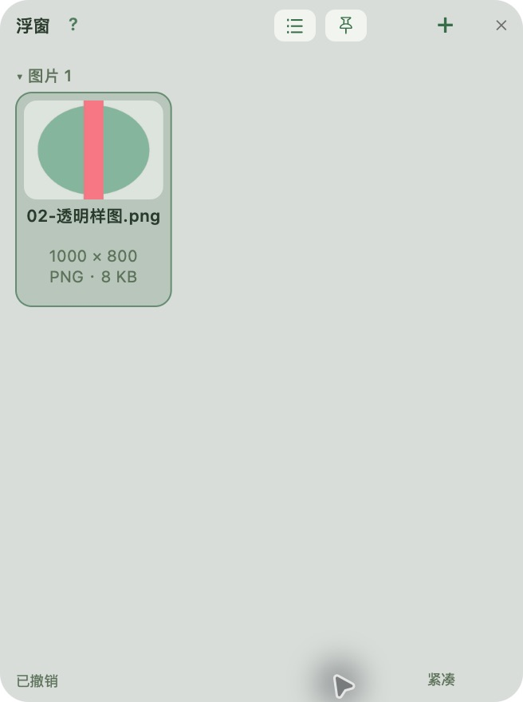

# Totori

**把文件拖进来，交给小爪子。**

Totori 是一个常驻菜单栏的 macOS 本地文件转换工具。森林绿、凝胶质感和会主动抓住文件的小爪子，让格式转换、文件暂存与结果对比集中在一个轻巧的界面里。

[下载 Apple Silicon 完整安装包](https://github.com/gzsteven666/Totori/releases/latest) · [安装说明](docs/INSTALL.zh.md) · [详细操作](README-zh.md) · [第三方依赖](THIRD_PARTY_NOTICES.md)



## 从拖入到拿走

- **拖拽花瓣**：拖动文件时按住 ⇧ Shift，移到目标格式，小爪子抓住文件后松手转换。顶部 JPEG 花瓣会提示透明背景的变化。
- **批量转换**：转换全部或选中项；支持取消当前任务、只重试失败项、继续未完成项。保留原件，同名输出自动避让。
- **文件简介**：图片显示像素与大小，视频增加时长，音频显示时长，PDF 显示页数。
- **文件浮窗**：拖入暂存、拖到访达拿走，支持撤销、网格/列表、紧凑模式与位置记忆。移除的是引用，磁盘原文件保留。
- **转换前后对比**：并排、分界线、缩放、锁定原图与批量上一张/下一张；显示体积变化。
- **最近任务**：查看本次运行中的最近十个批次，打开结果、对比或重试；退出后清空。
- **文件工具**：裁剪、标注、压缩、修剪、PDF 合并与拆页、ZIP 打包等。

| 图片对比 | 文件浮窗 |
| --- | --- |
|  |  |

截图使用合成测试文件；森林绿、凝胶质感与爪子保留在正式版中。

## 安装到另一台 Mac

1. 打开 [Releases](https://github.com/gzsteven666/Totori/releases/latest)。
2. 下载 **`Totori-0.3.9-macOS-arm64.zip`**。GitHub 自动生成的“Source code”是源码，不是安装包。
3. 解压，将 **Totori.app** 拖到“应用程序”，再打开。
4. 首次使用按应用提示开启辅助功能权限；使用读取访达选中项的功能时，允许对访达的自动化访问。

支持 **M 系列 Mac（arm64），macOS 13 或更高版本**。完整包已内置 FFmpeg、ffprobe、cwebp 和 LibreOffice，无需安装 Homebrew、Python、Java 或另一个 LibreOffice。解压后的体积主要来自文档转换引擎。

Totori 使用本地签名，**尚未经过 Apple Developer ID 签名及公证**。若 macOS 阻止首次打开，确认来自本仓库后，在“系统设置 → 隐私与安全性”中使用“仍要打开”；不要关闭系统安全保护。公司管理策略禁止时需由公司管理员处理。原始 LibreOffice 子包保留 The Document Foundation 签名。

文件在本机处理。转换不需要联网；访问 GitHub 下载需要联网。

## 格式范围

0.3.9 (30) 修复文档转 PDF 的中文字体发现：使用 App 内独立配置读取系统及用户字体。Excel（`.xlsx` / `.xls`）转 PDF 新增“Excel 排版”选项，默认保留原表设置；“适配页宽”按 A4 横向、1 页宽、高度自动导出，不修改原件。该选项位于主窗口，长表仍纵向分页。

| 类型 | 常用输出 |
| --- | --- |
| 图片 | PNG、JPEG、HEIC、TIFF、WebP、PDF 等 |
| 文档 | PDF、DOCX、ODT、RTF、HTML、TXT 等 |
| 视频 | MP4、MOV、MKV、WebM、AVI、WMV、GIF |
| 音频 | MP3、M4A、WAV、FLAC、AIFF、Opus 等 |
| 压缩包 | ZIP 打包 |

可用选项随输入类型变化。文档复杂排版、字体和特殊编码可能影响结果；先用副本检查重要文件。大图对比采用有提示的缩略预览，动图对比显示第一帧。`.pages` 输出未实现。

## 从源码构建

原生 Swift / SwiftUI / AppKit，编译需要 Apple Command Line Tools：

```sh
./build.sh
```

开发构建使用本机可用的转换工具。完整分发构建还需要 Python 3.12+：

```sh
python3 scripts/build-runtime.py --work-dir "$PWD/work/portable"
python3 scripts/package-release.py --runtime-work-dir "$PWD/work/portable" --output-dir "$PWD/dist"
```

固定版本、来源与校验值见 `scripts/runtime-lock.json`、`scripts/libreoffice-lock.json`。许可证与对应源码随 Releases 提供。详见 [第三方说明](THIRD_PARTY_NOTICES.md)。仓库不包含个人测试文件、运行记录、签名证书或 Homebrew 安装目录。

## 验证

[本次分发验收记录](docs/RELEASE_CHECKS.md)

运行安装包内的自检：

```sh
"/Applications/Totori.app/Contents/MacOS/XiaoJuConvert" --probe-runtime
"/Applications/Totori.app/Contents/MacOS/XiaoJuConvert" --selftest
"/Applications/Totori.app/Contents/MacOS/XiaoJuConvert" --probe-document-pdf
```

`--probe-runtime` 检查四个引擎均来自当前 App；`--selftest` 生成合成样本并测试转换。测试时先退出正在运行的 Totori。分发检查脚本 `scripts/verify-release.py` 还会检查架构、签名与非系统动态依赖。

当前发行版：**0.3.9 (30)**。在 Apple Silicon / macOS 27.2 上验证；macOS 13 是编译部署目标，尚未逐个实机验证所有旧版系统。

## License

Totori's own source code is released under the [MIT License](LICENSE). The bundled
  third-party programs (FFmpeg, x264, LAME, libvpx, Opus, libwebp, libpng, LibreOffice) are independent
  programs under their own licenses; see [THIRD_PARTY_NOTICES.md](THIRD_PARTY_NOTICES.md).
